 

<table>
<tr>
<td width="50%" valign="top">

### About

I enjoy turning real-world problems into reliable software — not just shipping features, but designing systems that are clean, maintainable, and built to scale.

My main focus is Full Stack Development and Backend Engineering: MERN, Django, REST APIs, databases, authentication, testing. I also explore Data Analytics and Machine Learning to build data-driven applications on the side.

**Currently**

- Software Engineering student at FAST-NUCES
- Building production-grade MERN and Django backends
- Breaking down big requirements into clean, testable pieces
- Always has a project running on the side

</td>
<td width="50%" valign="top">

</td>
</tr>
</table>

 

 

## Things I've Built

<a href="https://github.com/mshahnawaz1202/Product-Inventory-Management-System">Inventory Management</a> &nbsp;·&nbsp;
<a href="https://github.com/mshahnawaz1202/Banking-System">Banking System</a> &nbsp;·&nbsp;
<a href="https://github.com/mshahnawaz1202/Spotify-Clone-Backend">Spotify Clone Backend</a> &nbsp;·&nbsp;
<a href="https://github.com/mshahnawaz1202/Smart-City-Diagnostic-Engine">Smart City Diagnostic Engine</a> &nbsp;·&nbsp;
<a href="https://github.com/mshahnawaz1202/Customer-Segmentation-Recommendation-Engine">Customer Segmentation Engine</a> &nbsp;·&nbsp;
<a href="https://github.com/mshahnawaz1202/NYC-Congestion-Pricing-Audit">NYC Congestion Pricing Audit</a>

 

## The Numbers

  

 

## Reach Me

 

